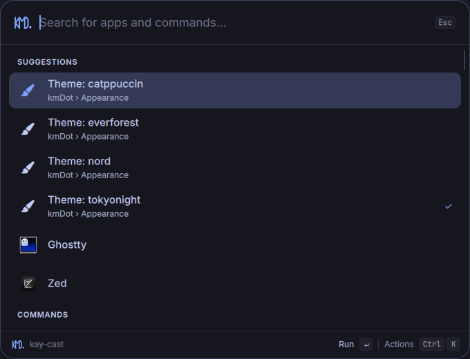

# kay-cast for CachyOS + kmDot

A Raycast-style launcher for the kmDot Hyprland desktop, forked from
[the upstream project](https://github.com/typecraft-dev/oma-cast).
Runs as a standalone Quickshell instance alongside your existing bar and menus.
Omarchy is no longer required.



The detailed porting plan, desktop inventory and validation record are in
[docs/CACHYOS-PORT.md](docs/CACHYOS-PORT.md). Original research and future feature
plans remain in [SPEC.md](SPEC.md) and reference/.

## What works

- Application search with the original ranker, learned terms and frecency.
- Favorites, aliases, disabling commands and a **Disabled Commands** view to restore them.
- kmDot menus: apps, clipboard, connections, Wi-Fi, Bluetooth, Handy, shortcuts,
  appearance, wallpapers and system/power controls. Power confirmation stays in kmDot.
- Direct theme choices with a checkmark on the current theme; screenshots,
  Ghostty, file manager and notification controls when their tools are available.
- Shortcut hints read by kmDot's own Lua binding inspector.
- The same kmDot vector logo as the topbar, following primary/accent theme colors.
- kmDot's generated colors, Adwaita Sans text with Nerd Font icons, a 680 px
  centered card, 20 px corners, semantic selection colors and surface outline. The card fits
  smaller displays and follows the focused Hyprland monitor.
- Calculator with mixed-unit, work-time and Unix-time expressions, configurable
  clock/rem settings, conversions, dates, currencies and calculator history.
- Google/DuckDuckGo quicklinks with inline query entry, plus browser fallbacks
  through `xdg-open`.
- Application/command search filters, item details, confirmation for clearing
  calculator history, undo for disabling commands, and clipboard paste in the
  launcher, action panel and quicklink fields.
- Emacs-style navigation by default, with optional Vim motions through general
  settings. The action panel moves to Alt+K in Vim mode.
- Explicit local agent hand-off to OpenCode, Codex or Claude in your terminal.
- Custom commands as literal argv arrays; no Node runtime or npm install.

## Install

Requires a running Hyprland Wayland session, Quickshell, bash, `wl-copy`,
`xdg-open`, and `notify-send`. Setup uses Python 3. kmDot supplies the desktop
scripts, generated palette and icon font. Text uses the installed Adwaita Sans
family (override with `KAY_CAST_FONT_FAMILY` in the service environment). `lua` enables shortcut hints; `wtype` enables
Paste Answer. Node is needed only for development tests.

From this checkout:

```sh
bin/kay-cast install
bin/kay-cast setup hyprland
bin/kay-cast doctor
```

The installed kmDot binding opens kay-cast with **Super+Space**. Fresh setups
created by the standalone installer use **Alt+Space** unless configured otherwise.
Existing shortcuts are preserved. Installation links
this checkout into `~/.config/kay-cast/runtime`, links the CLI into
`~/.local/bin`, and enables `kay-cast.service` for the graphical session.
Keep the checkout in place. Reinstall after moving it.

Setup supports Lua (`hl.bind`) and traditional Hyprland `.conf` files. It writes
an owned `kay-cast` module next to your installed Hyprland configuration and adds
one require/source. It rejects an occupied Alt+Space binding. Edit that module to
choose another key. kmDot sync can overwrite the require; rerun setup after
syncing Hyprland. The kmDot source repository is untouched.

kmDot's theme hook uses `pkill -x quickshell` while restarting its shell.
kay-cast runs under a separate user service and recovers after four seconds if
terminated; it never restarts or kills your bar. Color-file
updates alone apply live without losing launcher state. Before kmDot is synced,
a Tokyo Night fallback allows startup. An invalid palette preserves the last
valid colors and reports its error through `system.info` and the log. The palette
reader recovers when a kmDot sync replaces its containing directory and refreshes
again on launcher open.

Remove with `kay-cast uninstall`. Settings/history/custom commands are preserved.
Unmodified generated bindings are removed; customized binding files are retained.

Apps and desktop actions launch in independent user services. This keeps the
bar restarted by a theme action, browser windows, terminals and clipboard owners
alive when kay-cast reloads or stops. Manually starting without a systemd user
manager falls back to direct execution.

## Configuration

Files follow XDG paths (defaults below):

| File | Purpose |
|---|---|
| `~/.config/kay-cast/config.json` | Backend options, e.g. `{"currencyRates":false}` |
| `~/.config/kay-cast/commands.json` | Custom command catalog, watched live |
| `~/.config/kay-cast/environment` | Service environment; restart after edits |
| `~/.local/share/kay-cast/db/` | Versioned settings, frecency and calculator history |
| `~/.cache/kay-cast/` | Cached exchange rates |

Calculator options in `config.json` include `remToPxRate` (default `16`),
`workHoursPerDay` (default `8`) and `clockFormat` (`auto`, `12h` or `24h`).
General settings accept `navigationBindings: "emacs"` or `"vim-motions"`.

Optional service environment (plain `KEY=value` entries, no `export`):

```ini
KAY_CAST_AGENT=opencode
KAY_CAST_TERMINAL=ghostty
KMDOT_REDUCED_MOTION=1
# Optional override for the generated palette location:
# KAY_CAST_THEME_FILE=/absolute/path/to/Colors.qml
```

Then run `kay-cast reload`. Supported terminals: ghostty, kitty, foot, alacritty.
Defaults are OpenCode and Ghostty. Terminal desktop applications also use the
configured terminal, preserving their working directory and desktop field codes.

Custom command example:

```json
[
  {
    "id": "dotfiles",
    "title": "Open dotfiles",
    "subtitle": "kmDot",
    "keywords": ["config", "hyprland"],
    "argv": ["ghostty", "--working-directory=/home/kedarmd/dev/kmDot"]
  }
]
```

Use absolute paths: argv does not expand `~`, `$HOME`, pipes or shell code.
Invalid edits preserve the previous custom catalog and log the validation error.
Full general settings remain available through RPC:

```sh
kay-cast call settings.updateGeneralSettings '{"uiZoom":1.1,"windowMode":"compact"}'
```

## Keyboard and CLI

| Key | Action |
|---|---|
| Enter / Ctrl+Enter / Ctrl+Shift+Enter | First / second / third action |
| Ctrl+K | Action panel (Alt+K in Vim mode) |
| Ctrl+P | Application/command filter |
| Ctrl+Shift+K | Selected item details |
| Ctrl+T | Toast actions, when offered |
| Ctrl+1–9 | Quick pick |
| Ctrl+N / Ctrl+P | Next / previous in popups (Ctrl+J / Ctrl+K in Vim mode) |
| Ctrl+Up / Ctrl+Down | Jump sections |
| Up on empty search | Search history |
| Ctrl+Shift+F | Toggle favorite |
| Ctrl+Alt+Up / Down | Reorder favorites |
| Ctrl+Shift+C | Copy |
| Alt+Shift+D | Disable command |
| Ctrl+Alt+Enter | Explicitly ask the configured agent |
| Ctrl+V / Shift+Insert / Ctrl+U / Ctrl+W | Paste / clear / delete word |
| Escape / Shift+Escape | Back / root |
| Ctrl+Plus / Minus / 0 | Zoom |

```sh
kay-cast toggle | show | hide
kay-cast start | stop | reload
kay-cast run builtin:calculator-history
kay-cast call system.info
kay-cast call rootSearch.search '{"query":"theme"}'
```

Agent prompts remain literal arguments, are omitted from search history and
never submit while typing. A bounded preflight checks the installed agent and
terminal; hiding cancels the pending hand-off. Authentication, permissions and
agent working directory remain the terminal/CLI's responsibility. No embedded
model API or credentials are handled here.

## Development and limits

```sh
node --test tests/*.test.js
python3 tests/desktop-live.py   # isolated theme, app and terminal fixtures; requires Wayland
python3 tests/launch-lifecycle.py # disposable service; checks launched-process lifetime
tests/smoke.sh                # live desktop; briefly shows/hides launcher, sends no keys
kay-cast dev                   # optional inotify-tools
qs log -n -p "$PWD/shell.qml" -t 40
```

Source hot reload is disabled after a Qt/Wayland teardown crash in the installed
Quickshell. `reload` and `dev` restart only kay-cast. Theme/config data remains
watched live. See [CLAUDE.md](CLAUDE.md) for development conventions.

Real agent authentication, paste into another application and kmDot's full theme
switch need a controlled interactive check. Automated checks use isolated fixtures
and test service recovery by terminating only kay-cast. Keystrokes typed before
the layer maps remain an upstream limitation. Extension hosting, snippets, file
indexing, rayconfig import and a full settings window remain future work.

Independent clean-room project; no Raycast code/assets, Raycast server traffic
or telemetry. Original implementation and research credit: the upstream project.
